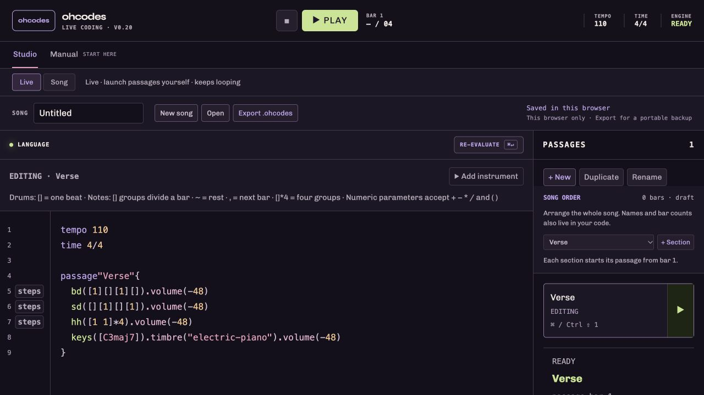

# ohcodes

A live-coding music environment for people who think in beats, notes, tracks and sections. Write a rhythm in code, edit the same rhythm in a step grid, and move between named passages while playing.

Created by **Haoran Hou**. This repository contains the standalone **browser prototype**, extracted from the portfolio version. It does not change or deploy the portfolio website.



## Run locally

Install Node.js **22.13 or newer** (Node 24 LTS is also supported), then:

```sh
npm ci
npm run dev
```

Open the local address printed by Vite, normally `http://127.0.0.1:5173`. No account, API key, database, MIDI device or DAW is required. Start with your listening volume low. The initial project is intentionally silent.

1. In **Studio**, add a hit in **Steps**, or write a rhythm in the editor.
2. Press **Play** to start audio. Browsers require a user action first.
3. Press **Cmd/Ctrl + Enter** to apply code. While playing, valid changes enter at the next bar; invalid drafts keep the last valid music playing.
4. Press **Stop** to stop playback and clear voices/effect tails.

The **Manual** tab contains English and Chinese lessons, complete examples and exercises. It does not replace or play your project automatically. See the [language reference](docs/ohcodes-language.md) for syntax and edge cases.

## A small example

```text
tempo 110
time 4/4

passage"Verse"{
  bd([1][][1][])
  sd([][1][][1])
  hh([1 1]*4).volume(-12)
  keys([C3maj7]).timbre("electric-piano").volume(-12)
}
```

Export your existing project before replacing its code with an example.

## What works in this version

- Text editing and a step editor that update the same musical source.
- Drum and melodic tracks, notes, chords, scales/degrees, arithmetic and repetitions.
- Passage-local named tracks, mute/solo, volume, velocity and swing.
- Built-in synthesized timbres and filter, delay and reverb effects with editable controls.
- **Live** passage launching and **Song** arrangement with bar-boundary changes.
- Syntax highlighting, inline help and diagnostics.
- Browser draft recovery and `.ohcodes` import/export, including unfinished drafts.

The sounds are synthesized with Web Audio, not sampled recordings of acoustic instruments. Instrument and classic drum-machine labels describe approximate synthesized timbres, not licensed sample libraries or accurate emulations.

## Scope

ohcodes is at an early prototype stage. This is **not** an external DAW controller or an AU/VST/Max for Live plug-in. External DAW integration and recordable automation are future work. Automated tests check implementation behavior; they are not evidence from a participant study or a guarantee of low-latency live performance on every device.

## Save your music

Drafts are stored locally in the browser for the current origin. Use **Export** / **Cmd/Ctrl + S** to save a `.ohcodes` file before clearing browser data or moving computers. A draft on the portfolio site is not automatically available on localhost; export there and open the file here. Browser storage is not a cloud backup.

The compatibility storage keys still use `ohsounds` so existing projects are not stranded by the rename. The project name and current file format are **ohcodes**.

## Checks and build

```sh
npm test          # 162 language, editing, project, scheduling and mocked-audio tests
npm run typecheck
npm run build    # typecheck and production bundle
npm run preview  # serve that bundle locally
```

GitHub Actions runs the checks on Node 22 and 24. `npm run check` also verifies the source manifest. After an intentional source change, inspect the diff and run `npm run manifest` before committing. Audio-node mocks test scheduling and cleanup without a sound device; listening and device/browser timing still require hands-on checks.

## Source map

| Location | Purpose |
| --- | --- |
| `components/ohcodes-workspace.tsx` | Studio, transport, graphical controls and project workflow |
| `components/ohcodes-manual.tsx` | Bilingual in-app manual |
| `lib/ohcodes-language.ts` | Parser, musical structure and source-preserving edits |
| `lib/ohcodes-expressions.ts` | Bounded arithmetic evaluator; no user JavaScript execution |
| `lib/ohcodes-editor.ts` | Highlighting, completion and diagnostics |
| `lib/ohcodes-tracks.ts`, `ohcodes-effects.ts`, `ohcodes-soundbanks.ts` | Web Audio routing, effects and synthesized voices |
| `lib/ohcodes-project.ts`, `ohcodes-song.ts` | Saved projects and arrangement playback |
| `lib/ohcodes-language.test.mjs` | Regression tests against the actual TypeScript modules |

The public package excludes portfolio content, its editor, authentication, upload APIs, databases, deployment bindings and private files. The standalone shell uses Vite and React; the musical engine is unchanged from the source snapshot listed in [PROVENANCE.md](PROVENANCE.md).

## Rights and dependencies

No open-source license has yet been selected for the original ohcodes code; publishing this repository does not grant additional reuse rights. Third-party dependencies retain their own licenses. The bundled Syne, Chivo and Newsreader fonts each include their SIL Open Font License and attribution in `public/fonts/`.
